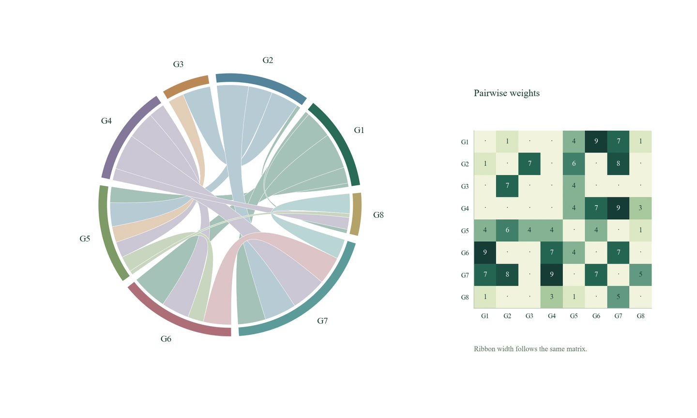

# ProjectX

**复杂关系，一图看清。**

探索ProjectX能够绘制的复杂图表类型，按用途选择两种绘图模式：

- **MATLAB → EMF**：使用MATLAB绘制，导出EMF矢量图。
- **Python → PNG**：使用Python绘制，按画布与分辨率导出PNG图像。

[访问网站](https://xiaonshen1031-eng.github.io/ProjectX/) · [下载技能](https://xiaonshen1031-eng.github.io/ProjectX/downloads/Senior-ProjectX-v1.1.0.zip) · [图型源码](gallery/README.md)



Copyright © NCEPU-Senior · Author: XiaoN

## 图型画廊

网站提供六类图型的MATLAB与Python实现，以及对应的EMF、PNG原图：

1. 轨迹包络与约束诊断
2. 条件分布山峦图
3. 弦带与关系矩阵
4. 聚类关系矩阵
5. 空间场与节点网络
6. 可行域与状态投影

演示采用独立生成的示意数据。绘图代码、数据定义及复现方法见 [gallery](gallery/README.md)。

## 使用

下载技能包并解压，保留 `senior-projectx` 的目录结构，让能读取本地文件、运行脚本的研究助手读取 `SKILL.md`。完整技能内容见 [技能说明](skill/senior-projectx/SKILL.md)。

可以从这段提示开始：

> 请使用Senior-ProjectX，先明确当前数据需要表达的关系，再选择适合的复杂图型。采用MATLAB绘制并导出EMF，或采用Python绘制并导出PNG；检查字体、图例、轴标、配色和比例，提交绘图源码与最终图件。

MATLAB / EMF模式使用本地Windows MATLAB。Python / PNG模式使用Python科学计算与绘图库。

```powershell
python -m pip install -r skill/senior-projectx/requirements.txt
python gallery/build_python.py
matlab -batch "addpath('gallery'); build_matlab"
python tools/prepare_gallery.py
python tools/verify_site.py
```

## 网站源码

静态网站位于 `docs/`，由GitHub Pages发布。可在本地预览：

```powershell
python -m http.server 8769 --directory docs
```

技能源文件位于 `skill/senior-projectx/`。`tools/build_release.py` 生成技能下载包，`tools/verify_site.py` 检查公开资源、格式、下载包及发布范围。

## 许可

ProjectX代码与演示图件采用 [MIT许可](LICENSE)，Manrope字体采用 [SIL Open Font License](docs/assets/fonts/OFL.txt)。
